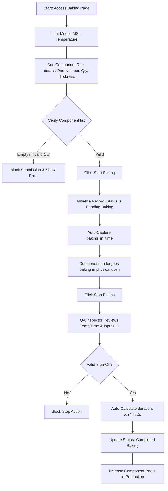

# SMT Manufacturing Execution System (MES)
## VERSION 2.0: BAKING TRACKING RECORD

### 1. DOCUMENT CONTROL & VERSION INFORMATION
| Metadata Field | Value |
| :--- | :--- |
| **Module Name** | Baking Tracking Record |
| **Module Version** | 2.0 |
| **Document Version** | 2.0.0 |
| **Last Updated Date** | 2026-06-27 |
| **Author** | SMT Quality and Software Engineering Group |

#### Revision History
| Version | Date | Author | Description of Change |
| :--- | :--- | :--- | :--- |
| 2.0.0 | 2026-06-27 | SMT Quality & SE Group | Initial release detailing the component baking controls, MSL validation, and dynamic timers. |

---

### 2. MODULE OVERVIEW
The **Baking Tracking Record** module regulates the conditioning of moisture-sensitive devices (MSDs) before they are mounted onto circuit boards. Electronic components absorb humidity from the atmosphere over time. When these components pass through high-temperature reflow ovens, trapped moisture expands rapidly, causing internal cracking or delamination (often referred to as the "popcorn effect"). Baking MSDs at controlled temperatures evaporates this moisture safely.

---

### 3. PURPOSE
Baking is a critical pre-production step that restores the safe mounting window for components. This module:
*   Enforces structured logs of when components go into and come out of the baking oven.
*   Enables dynamic component lists so multiple reels can be tracked under a single baking batch.
*   Computes exact baking durations (e.g. `4h 12m 30s`) and formats timestamps to Indian Standard Time (IST) using a 12-hour AM/PM format.
*   Prevents unbaked or expired MSDs from entering production by making QA sign-off mandatory before baking-out.

---

### 4. NAVIGATION
Users can access this page by:
1. Logging into the SMT Portal.
2. Expanding the sidebar and selecting **SMT -> Baking Tracking Record**.
3. Direct URL access route: `/smt/baking-tracking`.

---

### 5. PAGE OVERVIEW & LAYOUT
The Baking page features a user-friendly layout:
1.  **Baking Registration Panel**: Form to register the model name, MSL level, oven temperature, and add multiple component reels dynamically.
2.  **Pending Baking Grid**: Displays all components currently in the oven, showing the start time and elapsed duration.
3.  **Completed Baking Grid**: Displays finished runs, displaying the out-time, total duration, and QA verifier name.

---

### 6. PROCESS FLOW DIAGRAM
The following flow diagram illustrates the baking process and QA release:

---

### 7. STEP-BY-STEP USER GUIDE
1.  Navigate to `/smt/baking-tracking`.
2.  Enter the **Model Name**, select the **MSL Level** (MSL 1 to MSL 6), and input the **Baking Temperature** (°C).
3.  In the components sub-form, enter the **VEPL Part Number**, **Manufacturer Part Number**, **Reel Qty**, and **Component Thickness** (mm). Click "Add Reel" to append multiple reels.
4.  Enter the **Operator ID** and click **Start Baking** (Baking-In).
5.  When baking is physically complete, click **Stop Baking** (Baking-Out) on the active row.
6.  Enter the **QA Inspector ID** in the sign-off dialog.
7.  Click **Confirm**. The row transitions to the completed history table.

---

### 8. FORM FIELDS
The form captures oven parameters and component reel dimensions.

---

### 9. FIELD DESCRIPTION TABLE
| Field Name | Purpose | Data Type | Mandatory | Example Value | Validation Rules |
| :--- | :--- | :--- | :--- | :--- | :--- |
| **Model Name** | Product assembly code. | Text | Yes | `SMT-PRO-V2` | Cannot be empty. |
| **MSL Level** | Moisture Sensitivity Level rating. | Dropdown Selection | Yes | `MSL 3` | Must be a valid MSL standard level. |
| **Baking Temperature** | Target oven temperature. | Number | Yes | `125` | Must be a positive integer in degrees Celsius. |
| **VEPL Part Number** | Internal component identifier. | Text | Yes | `VEPL-CAP-100` | Mandatory for each reel. |
| **Manufacturer Part No** | Supplier part identifier. | Text | Yes | `GRM188R61C105KA93D` | Mandatory for each reel. |
| **Reel Qty** | Quantity of components on the reel. | Number | Yes | `4000` | Must be an integer greater than zero. |
| **Component Thickness**| Thickness dimension. | Text | Yes | `0.8 mm` | Cannot be empty. |
| **QA Approved By** | QA Inspector signing off on release. | Text | Yes | `QA-9883` | Required during Baking-Out step. |

---

### 10. VALIDATION RULES
*   **Reel Quantity check**: The system blocks any reel quantity $\le$ 0.
*   **Component List check**: A baking batch cannot be registered without at least one component reel.
*   **QA Approval Gate**: The system blocks stopping the baking process unless the QA inspector ID is entered and verified.

---

### 11. BUSINESS RULES
*   **Why is MSL level tracked?** MSL levels (from MSL 2 to MSL 6) determine how long a component can remain exposed to room humidity before it must be baked. Higher MSL levels require longer baking times.
*   **Why are reel quantities tracked?** Tracking quantities ensures that when components are issued to assembly lines, we can verify that the baked quantity matches the work order consumption.
*   **Why is the baking duration calculated by the system?** Manual calculations are prone to errors. Automated timestamp differences ensure accurate records for quality audits.

---

### 12. WORKFLOW LOGIC & PROGRESSION
*   **Baking-In**: Transitions record to `Pending Baking` status. Sets `baking_in_time` to current time.
*   **Baking-Out**: Transitions status to `Completed Baking`. Records `baking_out_time` and calculates total elapsed duration (e.g. `2h 15m 10s`).

---

### 13. USER ROLES & PERMISSIONS
*   **SMT Operators**: Allowed to create baking records, add component reels, and start baking timers.
*   **QA Inspectors**: Authorized to sign off on completion (Baking-Out approval).
*   **Super Admins**: Allowed to soft-delete baking records.

---

### 14. GRID & TABLE COLUMN DESCRIPTIONS
#### Baking Records Grid
*   **Baking Batch ID**: System-generated tracking ID.
*   **Model Name**: Target product model.
*   **First Component Part Number**: Reference part ID.
*   **Baking Temperature & MSL**: Target baking settings.
*   **Baking In Time**: Start timestamp (IST format: `DD-MM-YYYY hh:mm:ss AM/PM`).
*   **Baking Out Time**: Completion timestamp (IST format).
*   **Total Baking Duration**: Elapsed baking duration.
*   **Status**: `Pending Baking` or `Completed Baking`.

---

### 15. USER ACTIONS
*   **Start Baking**: Saves batch detail and starts timer.
*   **Stop Baking**: Displays verification modal to end baking.
*   **View Details**: Opens a details panel to view all reels in the batch.

---

### 16. APPROVAL PROCESS
1.  Operator clicks **Stop Baking** on a pending batch.
2.  QA inspector reviews the physical oven logs.
3.  QA inspector signs off by entering their employee ID.
4.  System records the approval and releases the batch.

---

### 17. AUDIT & TRACEABILITY
*   All additions, completions, and deletions are saved in the database.
*   Deleting a record (Super Admin only) flags `is_deleted = true` but retains the row in the database for future quality audit checks.

---

### 18. ERROR MESSAGES
*   *Error*: `"Reel Quantity must be greater than zero for all components."*
    *   **Reason**: Operator entered a negative or zero quantity.
*   *Error*: `"Approved By QA is mandatory."*
    *   **Reason**: Operator left the QA verifier ID blank during Baking-Out.

---

### 19. TROUBLESHOOTING
*   **Issue**: Component details do not match the physical reel.
    *   **Solution**: If the record is still pending, a Super Admin can soft-delete the batch so the operator can re-register it with correct details.
*   **Issue**: Dynamic "Add Reel" button is disabled.
    *   **Solution**: Verify that all fields in the current reel row are filled out before adding another.

---

### 20. FREQUENTLY ASKED QUESTIONS (FAQ)
*   **Can we bake different MSL level components in the same batch?**
    *   Yes, if they share the same baking temperature, but the baking duration must match the longest required time for the highest MSL level component.
*   **How are timestamps displayed?**
    *   All timestamps are converted to Indian Standard Time (IST) using the format: `DD-MM-YYYY hh:mm:ss AM/PM`.

---

### 21. SUMMARY & BEST PRACTICES
*   Always load the component reels neatly into the oven racks to ensure uniform heat circulation.
*   Verify that the oven temperature matches the recipe requirements before clicking "Start Baking".
