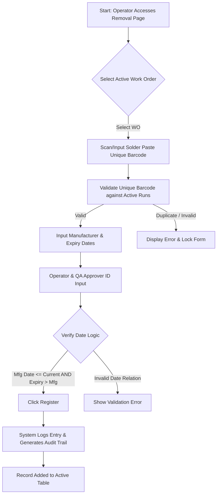

# SMT Manufacturing Execution System (MES)
## VERSION 2.0: SOLDER PASTE REMOVAL FROM REFRIGERATOR

### 1. DOCUMENT CONTROL & VERSION INFORMATION
| Metadata Field | Value |
| :--- | :--- |
| **Module Name** | Solder Paste Management - Stage 1 |
| **Module Version** | 2.0 |
| **Document Version** | 2.0.0 |
| **Last Updated Date** | 2026-06-27 |
| **Author** | SMT Quality and Software Engineering Group |

#### Revision History
| Version | Date | Author | Description of Change |
| :--- | :--- | :--- | :--- |
| 2.0.0 | 2026-06-27 | SMT Quality & SE Group | Initial release detailing the refrigerator removal registration controls. |

---

### 2. MODULE OVERVIEW
The **Removal from Refrigerator** page is the first critical checkpoint in the solder paste conditioning cycle. It records the transition of a specific solder paste jar from a controlled refrigeration environment (typically maintained at 2°C to 10°C) into the room-temperature shop floor.

---

### 3. PURPOSE
Solder paste must not be used cold. Doing so causes ambient moisture to condense onto the paste, leading to outgassing and solder spattering (micro-explosions) during the reflow soldering process. The primary purpose of this page is to log the exact second a jar leaves the refrigerator to initialize the warming countdown, ensuring full traceability of the paste's ambient exposure.

---

### 4. NAVIGATION
Users can access this page by:
1. Navigating to the main **Solder Paste Management** dashboard.
2. Clicking on the **Stage 1: Removal From Fridge** tab, OR navigating directly to the URL route: `/smt/solder-paste/removal`.

---

### 5. PAGE OVERVIEW & LAYOUT
The page interface consists of three distinct layouts:
1.  **Work Order Selection and Barcode Entry Form**: A clean, centralized form where operators select the production run and scan the paste barcode.
2.  **Solder Paste Properties Card**: Displays detailed information about the container (Manufacturer, dates) once scanned or entered.
3.  **Active Removal Records Table**: A grid displaying all jars currently removed under the current shift, highlighting status and allowing correction actions.

---

### 6. PROCESS FLOW DIAGRAM
The following flow diagram details the removal stage registration and verification:

---

### 7. STEP-BY-STEP USER GUIDE
1.  Navigate to `/smt/solder-paste/removal`.
2.  Select the active **Work Order ID** from the drop-down menu.
3.  Place the cursor in the **Solder Paste Barcode** input and scan the physical barcode on the jar.
4.  Enter the **Manufacturer Name** and **Solder Paste Name** as labeled on the jar.
5.  Input the **Manufacturing Date** and **Expiry Date** using the calendar pickers.
6.  Enter the **Operator ID** and **QA Inspector ID** to authorize the removal.
7.  Click the **Register** button. Verify that a success message is displayed.

---

### 8. FORM FIELDS
The form fields ensure correct material is pulled and logged. Each field requires precise data input to satisfy safety validations.

---

### 9. FIELD DESCRIPTION TABLE
| Field Name | Purpose | Data Type | Mandatory | Example Value | Validation Rules |
| :--- | :--- | :--- | :--- | :--- | :--- |
| **Work Order ID** | Links the jar to the targeted PCB batch. | Dropdown Selection | Yes | `WO202606200002` | Must be an active, uncompleted work order. |
| **Solder Paste Barcode** | Unique barcode/ID of the jar. | Text / Scanner Input | Yes | `SP-B40291` | Must be unique; cannot match any active thawing or mixing jar. |
| **Paste Name** | Specific chemical formula model. | Text | Yes | `SAC305 T4` | Cannot contain special symbols. |
| **Manufacturer** | Material supplier. | Text | Yes | `Senju Metal` | Minimum 2 characters. |
| **Mfg Date** | Date of material synthesis. | Date | Yes | `2026-04-15` | Cannot be a future date. |
| **Expiry Date** | Manufacturer shelf expiration. | Date | Yes | `2026-10-15` | Must be after Mfg Date and in the future. |
| **Operator Name/Code** | Identifies who performed the physical removal. | Text | Yes | `OP-1002` | Must be an authorized SMT operator. |
| **QA Approved By** | Identifies the QA staff inspecting the jar. | Text | Yes | `QA-9883` | Must be a certified QA credentials holder. |

---

### 10. VALIDATION RULES
*   **Duplicate Barcode Check**: If the system detects a jar with the same Barcode ID is already active in Thawing or Mixing, it rejects the submission.
*   **Future Date Check**: The system blocks any Manufacturing Date that is in the future.
*   **Expiration Precedence**: The Expiry Date must be strictly greater than the Manufacturing Date.
*   **Shelf-Life Expiry Check**: Jars that have already reached or passed their Expiry Date are blocked and flagged for disposal.

---

### 11. BUSINESS RULES
*   **Why is barcode scanning preferred over manual typing?** Manual entry is highly susceptible to typos, which compromises traceability during downstream audits. Scanning guarantees absolute tracking accuracy.
*   **Why must Expiry Date be validated at removal?** Once a jar is warmed, it cannot be put back in the refrigerator. Verifying the expiration date *before* removal prevents wasting expensive material.
*   **Why do we require QA Sign-off at removal?** Solder paste chemical integrity requires visual inspection of the jar seal. QA must verify the container is physically intact before warming begins.

---

### 12. WORKFLOW LOGIC & PROGRESSION
Upon successful submission, the system:
1.  Creates a new removal log record.
2.  Writes an inspection entry to the audit trail.
3.  Flags the selected Work Order's solder paste stage 1 status as **Completed**.
4.  Appends the record to the table grid for operator verification.

---

### 13. USER ROLES & PERMISSIONS
*   **Operators**: Can scan, enter form details, and register removal.
*   **QA Engineers / Supervisors**: Required to input their credentials to approve the removal registration.
*   **Super Admin**: Can perform corrections, and execute soft-delete actions on incorrectly logged entries.

---

### 14. GRID & TABLE COLUMN DESCRIPTIONS
#### Removal Records Grid
*   **Unique Barcode**: Scanned container identification.
*   **Work Order ID**: Target production job.
*   **Paste Model / Manufacturer**: Chemistry and brand.
*   **Operator / Shift**: Logged personnel details.
*   **Removal Time**: Timestamp when the jar was taken out.
*   **QA Approver**: Credentials of verifying QA staff.

---

### 15. USER ACTIONS
*   **Register**: Submits the verified form.
*   **Soft Delete / Cancel**: Authorized supervisors can remove a row if a typo was made. Soft delete flags the record as inactive but retains it in the audit trail.

---

### 16. APPROVAL PROCESS
The approval workflow requires:
1.  Operator fills the form.
2.  QA Inspector reviews the physical container seal, verifies dates, and inputs their QA Employee ID.
3.  Form registration succeeds only with dual credentials input.

---

### 17. AUDIT & TRACEABILITY
*   All removal records are permanent and timestamped.
*   If a record is soft-deleted, the database retains the row with a deletion flag and tracks who deleted it, when, and why.

---

### 18. ERROR MESSAGES
*   *Error*: `"Solder Paste Barcode is already registered in an active process."*
    *   **Reason**: The jar is already in the system.
*   *Error*: `"Expiry date must be after manufacturing date."*
    *   **Reason**: Invalid date inputs.

---

### 19. TROUBLESHOOTING
*   **Issue**: Scanner inputs the barcode but nothing happens.
    *   **Solution**: Ensure the cursor is focused inside the barcode input field before scanning.
*   **Issue**: Form rejects QA Employee ID.
    *   **Solution**: Verify the QA inspector is active in the employee master database.

---

### 20. FREQUENTLY ASKED QUESTIONS (FAQ)
*   **What if I register a jar under the wrong Work Order?**
    *   An SMT supervisor or admin must soft-delete the incorrect record. The operator can then scan and re-register the jar under the correct Work Order.
*   **Can we re-refrigerate a jar if the line stops?**
    *   No. Once removed and warming begins, the thermal cycle must be completed.

---

### 21. SUMMARY & BEST PRACTICES
*   Always inspect the physical container seal before scanning.
*   Keep the scanner lens clean to avoid reading errors.
*   Verify that the physical jar label details match the screen inputs exactly.
