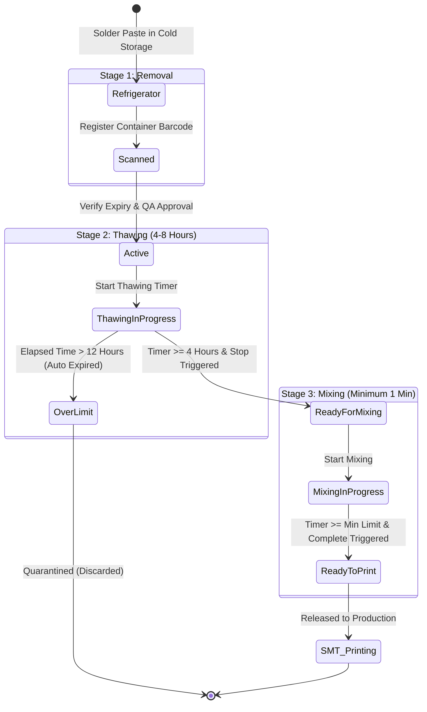

# SMT Manufacturing Execution System (MES)
## VERSION 2.0: SOLDER PASTE MANAGEMENT MODULE OVERVIEW

### 1. DOCUMENT CONTROL & VERSION INFORMATION
| Metadata Field | Value |
| :--- | :--- |
| **Module Name** | Solder Paste Management |
| **Module Version** | 2.0 |
| **Document Version** | 2.0.0 |
| **Last Updated Date** | 2026-06-27 |
| **Author** | SMT Quality and Software Engineering Group |

#### Revision History
| Version | Date | Author | Description of Change |
| :--- | :--- | :--- | :--- |
| 2.0.0 | 2026-06-27 | SMT Quality & SE Group | Initial release of Version 2.0 documentation representing database-driven and stage-based controls. |

---

### 2. MODULE OVERVIEW
The **Solder Paste Management** module is an enterprise-grade process control system designed to regulate and track the lifecycle of solder paste containers from their removal from cold storage to their deployment on SMT printing machines. 

Solder paste is a highly temperature-sensitive material. Running solder paste without proper thermal conditioning (thawing to ambient temperature) and uniform mechanical conditioning (mixing) leads to severe manufacturing defects, such as dry joints, solder balling, bridging, and voiding. This module enforces strict, auditable gates to guarantee that every paste container complies with manufacturer-specified thawing and mixing thresholds before physical application.

---

### 3. PURPOSE
The primary purpose of the Solder Paste Management module is to eliminate human error during the thermal preparation of solder paste. It serves as a digital safety gate by:
*   **Enforcing Thawing Rules**: Preventing the use of cold solder paste which causes moisture condensation and subsequent solder spattering during reflow.
*   **Enforcing Mixing Rules**: Guaranteeing paste viscosity is perfectly conditioned for clean screen printing release.
*   **Preventing Shelf Expiry**: Rejecting paste containers that have exceeded their manufacturer shelf-life or maximum allowable room-temperature duration (12-hour limit).
*   **Providing Complete Traceability**: Logging the operator identity, QA inspector approval, and exact process timestamps for every container used on the shop floor.

---

### 4. NAVIGATION
Users can access this module via the main SMT Navigation Panel:
1. Log in to the SMT execution portal with authorized credentials.
2. Expand the sidebar menu and navigate to **SMT**.
3. Under SMT, select **Solder Paste Management** (`/smt/solder-paste`) to access the main status dashboard and work order tracking panel.
4. For stage-specific workflows, select the sub-menus:
    *   **Removal from Refrigerator**: `/smt/solder-paste/removal`
    *   **Thawing**: `/smt/solder-paste/thawing`
    *   **Mixing**: `/smt/solder-paste/mixing`

---

### 5. PAGE OVERVIEW & LAYOUT
The main **Solder Paste Management Dashboard** is divided into three key areas:
1.  **Dashboard KPI Cards**: Displays real-time counts of work orders at each phase:
    *   `Pending Prep`: Containers requiring removal registration.
    *   `Thawing (In Progress)`: Containers currently under countdown timer.
    *   `Ready For Mixing`: Thawing successfully completed, ready for mixing.
    *   `Completed`: Conditionally prepared, ready to print.
2.  **Interactive Tabs**: Allows operators to switch between:
    *   `Stage 1: Removal From Fridge`: Registration form for scanned paste containers.
    *   `Stage 2: Thawing Timer`: Real-time tracking and countdown clock of thawing containers.
    *   `Stage 3: Paste Mixing`: Start/Complete interface for mechanical mixing.
3.  **Process History Grid**: Comprehensive table showing recently processed batches, operator logs, and exact timestamps.

---

### 6. PROCESS FLOW DIAGRAM
The following diagram represents the lifecycle of a solder paste container:

---

### 7. STEP-BY-STEP USER GUIDE
1.  **Select active work order**: In the SMT dashboard, choose the designated Work Order from the drop-down.
2.  **Removal Registration**: Scan the unique barcode of the solder paste jar and record operator and QA sign-offs.
3.  **Initiate Thawing**: Move to the Thawing control panel, verify the container details, and click "Start Thawing". The system initializes a 4-hour countdown.
4.  **Complete Thawing**: Once the countdown is complete, a QA inspector must approve the thawing completion. The status changes to "Ready For Mixing".
5.  **Perform Mixing**: Navigate to the Mixing panel, place the jar in the mechanical mixer, click "Start Mixing".
6.  **Complete Mixing**: After the minimum mixing time has elapsed, sign off alongside QA to mark the container "Ready for Production".

---

### 8. FORM FIELDS
The module captures essential manufacturing parameters across its stages. The key input fields are:
*   **Work Order ID**: Binding the paste to a specific production run.
*   **Solder Paste Barcode / Unique ID**: Identifying the individual container.
*   **Paste Name & Manufacturer**: Validating chemistry matching.
*   **Mfg Date & Expiry Date**: Preventing expired material usage.
*   **Operator & QA Employee Identifiers**: Recording accountability.

---

### 9. FIELD DESCRIPTION TABLE
| Field Name | Purpose | Data Type | Mandatory | Example Value | Validation Rules |
| :--- | :--- | :--- | :--- | :--- | :--- |
| **Work Order ID** | Links paste tracking to the production job. | Text | Yes | `WO202606200001` | Must exist in `smt_work_orders`. |
| **Solder Paste Barcode** | The unique serial identifier scanned from the jar. | Text | Yes | `SP-1029-A` | Must be alphanumeric and unique in active runs. |
| **Paste Name** | Name of the solder paste product. | Text | Yes | `Indium 8.9HF` | Cannot be empty. |
| **Manufacturer** | Brand producing the paste. | Text | Yes | `Indium Corporation` | Cannot be empty. |
| **Mfg Date** | Date the paste was manufactured. | Date | Yes | `2026-05-10` | Must be a past or current date. |
| **Expiry Date** | Expiry date stamped on the jar. | Date | Yes | `2026-11-10` | Must be greater than the Mfg Date. |
| **Operator ID** | Employee code of the executing operator. | Text | Yes | `OP-4039` | Must be a registered operator. |
| **QA ID** | Employee code of the verifying QA inspector. | Text | Yes | `QA-9021` | Must be a registered QA staff member. |

---

### 10. VALIDATION RULES
1.  **Duplicate Scanning Prevention**: A barcode cannot be registered if it is currently in an active removal, thawing, or mixing run.
2.  **Date Validation**:
    *   `Manufacturer Date` $\le$ `Current System Time` (Future manufacturing dates are blocked).
    *   `Expiry Date` $>$ `Manufacturer Date`.
    *   `Current System Time` $<$ `Expiry Date` (Expired jars are rejected instantly).
3.  **Minimum Thawing Duration**: System blocks stopping the thawing timer before the configured minimum period (production target: 4 hours; testing environment: 1 minute).
4.  **Maximum Working Limit**: If a container stays in the thawing stage past 12 hours (43,200 seconds), it is automatically classified as `OVER_LIMIT` and blocked from mixing.
5.  **Minimum Mixing Duration**: Mechanical mixing must run for at least 1 minute. Stop action is disabled before this timer finishes.

---

### 11. BUSINESS RULES
*   **Why does the 4-hour Thawing Rule exist?** Solder paste stored at 2–10°C will accumulate condensation if opened immediately at room temperature. Moisture in the paste causes explosions and voiding during reflow. A minimum 4-hour warming ensures the paste reaches thermal equilibrium naturally.
*   **Why does the 12-hour Maximum Limit exist?** After 12 hours at room temperature, the flux chemistry begins to degrade. Activators degrade and volatile solvents evaporate, altering viscosity and compromising printing quality.
*   **Why is QA sign-off mandatory?** Dual-signature verification ensures that a certified inspector has visually checked the packaging, validated the expiry date, and verified that timers were respected before the material enters the production line.

---

### 12. WORKFLOW LOGIC & PROGRESSION
The workflow is strictly sequential:
1.  **Pending $\rightarrow$ Removal (Stage 1 Completed)**: Populates `solder_paste_barcode` and logs the removal timestamps.
2.  **Removal $\rightarrow$ Thawing (Stage 2 In Progress)**: Initiates the countdown timer. Status transitions to `In Progress`.
3.  **Thawing $\rightarrow$ Ready For Mixing**: Occurs after timer requirements are met and stop is confirmed. Status updates to `Ready For Mixing`.
4.  **Ready For Mixing $\rightarrow$ Mixing (Stage 3 In Progress)**: Mechanical mixer spins. Status is `In Progress`.
5.  **Mixing $\rightarrow$ Completed**: Stop mixing verified. Status updates to `Completed`. Paste is released for Printing.

---

### 13. USER ROLES & PERMISSIONS
| Role | Removal Registration | Thawing Timer Start | Thawing Stop (QA) | Mixing Start | Mixing Stop (QA) | Record Deletion |
| :--- | :--- | :--- | :--- | :--- | :--- | :--- |
| **Operator** | Allowed | Allowed | Restricted | Allowed | Restricted | Restricted |
| **QA Engineer** | Allowed | Allowed | Allowed | Allowed | Allowed | Restricted |
| **Supervisor** | Allowed | Allowed | Allowed | Allowed | Allowed | Restricted |
| **Super Admin** | Allowed | Allowed | Allowed | Allowed | Allowed | Allowed |

---

### 14. GRID & TABLE COLUMN DESCRIPTIONS
#### Completed Production Batches Grid
*   **Record ID**: System-generated serial code linking the log entry.
*   **Unique ID / Barcode**: Checked container serial barcode.
*   **Paste Name / Manufacturer**: Identity of the material.
*   **Stage 1 Operator & Timestamp**: Who removed the jar and when.
*   **Stage 2 Start, End, & Duration**: Full thawing parameters.
*   **Stage 3 Start, End, & Duration**: Mechanical mixing duration parameters.
*   **Overall Status**: Current readiness of the paste.

---

### 15. USER ACTIONS
*   **Register**: Submits scanned barcode and material details to write to the database.
*   **Start Thawing**: Launches the countdown time tracker.
*   **Stop Thawing**: Prompts the verification window to close the thawing phase.
*   **Start Mixing**: Begins mechanical timer.
*   **Stop Mixing**: Verifies viscosity completion parameters and releases the paste jar.

---

### 16. APPROVAL PROCESS
1.  At the end of **Thawing**, the operator clicks **Stop**.
2.  The system displays an **Approvals Modal**.
3.  The operator enters their credentials.
4.  The QA inspector reviews the elapsed duration and signs off by entering their employee ID.
5.  Only when both signatures are authorized does the system transition the container status.

---

### 17. AUDIT & TRACEABILITY
Every action is audited within the `smt_inspections` database table:
*   Logs the ID of the scanned container.
*   Captures the exact IP/Host, operator, and QA IDs.
*   Captures exact timestamps for start and completion of each stage.
*   System audit entries are generated automatically for system-level actions (e.g., auto-transitioning to `OVER_LIMIT`).

---

### 18. ERROR MESSAGES
*   *Error*: `"Thawing must be completed (minimum 4 hours) before starting Mixing."*
    *   **Trigger**: Operator attempts to start mixing before the thawing timer completes.
*   *Error*: `"This container is already undergoing or has completed thawing."*
    *   **Trigger**: Scanning a duplicate barcode that is already active.
*   *Error*: `"Paste Expiry Date must be greater than Manufacturer Date."*
    *   **Trigger**: User enters a manufacturing date that is after the expiry date.

---

### 19. TROUBLESHOOTING
*   **Issue**: Timer did not transition to "Ready for Mixing" after 4 hours.
    *   **Solution**: Refresh the dashboard. The system recalculates elapsed durations on component load/render and updates the DB.
*   **Issue**: Container barcode rejected.
    *   **Solution**: Check if the barcode has already been scanned in a previous active work order. If yes, it must complete the process or be deleted by an admin.

---

### 20. FREQUENTLY ASKED QUESTIONS (FAQ)
*   **Can we skip thawing if the ambient room temperature is already high?**
    *   No. Fast warming causes uneven distribution and structural condensation. The 4-hour warming period is mandatory.
*   **What happens if a container goes OVER LIMIT?**
    *   It is flagged in red on the dashboard, locked from mixing, and must be disposed of or returned to QA for quarantine testing.

---

### 21. SUMMARY & BEST PRACTICES
*   Always scan the barcode immediately upon refrigerator removal.
*   Do not leave paste jars at room temperature for more than 12 hours.
*   Verify that mechanical mixing is done for the full duration to prevent printing errors.
