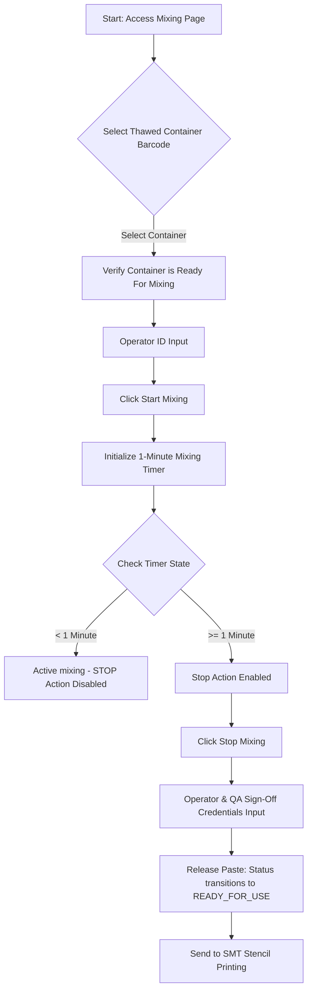

# SMT Manufacturing Execution System (MES)
## VERSION 2.0: SOLDER PASTE MIXING PROCESS CONTROL

### 1. DOCUMENT CONTROL & VERSION INFORMATION
| Metadata Field | Value |
| :--- | :--- |
| **Module Name** | Solder Paste Management - Stage 3 |
| **Module Version** | 2.0 |
| **Document Version** | 2.0.0 |
| **Last Updated Date** | 2026-06-27 |
| **Author** | SMT Quality and Software Engineering Group |

#### Revision History
| Version | Date | Author | Description of Change |
| :--- | :--- | :--- | :--- |
| 2.0.0 | 2026-06-27 | SMT Quality & SE Group | Initial release detailing the mechanical mixing controls and 1-minute validation logic. |

---

### 2. MODULE OVERVIEW
The **Solder Paste Mixing** page manages the final stage of solder paste conditioning: mechanical mixing. After a paste container completes the thawing warming period, it must undergo mechanical mixing to ensure homogeneous distribution of the solder metal alloy particles and flux components.

---

### 3. PURPOSE
Solder paste consists of heavy metal alloy powder suspended in a lighter flux vehicle. During storage, gravity causes the heavy solder particles to settle at the bottom of the container. If printed in this state, the paste deposit will be inconsistent, resulting in print defects such as insufficient solder, bridging, and solder balling. Mechanical mixing conditions the paste's viscosity to the optimal level for clean stencil release.

---

### 4. NAVIGATION
Users can access this page by:
1. Navigating to the main **Solder Paste Management** dashboard.
2. Clicking on the **Stage 3: Paste Mixing** tab, OR navigating directly to the URL route: `/smt/solder-paste/mixing`.

---

### 5. PAGE OVERVIEW & LAYOUT
The Mixing page is organized into sections for clear operational flow:
1.  **Mixing Initiation Panel**: Operator selects a thawed container and enters credentials to start the mixing timer.
2.  **Active Mixing Grid**: Displays containers currently inside the mechanical mixer with a live mixing timer.
3.  **Completed Mixing Grid**: Lists jars that have successfully finished mixing and are ready to be dispatched to the stencil printing machines.

---

### 6. PROCESS FLOW DIAGRAM
The following flow diagram illustrates the mixing validation and release steps:

---

### 7. STEP-BY-STEP USER GUIDE
1.  Navigate to `/smt/solder-paste/mixing`.
2.  In the initiation panel, select the target **Container Barcode** from the dropdown list.
3.  Input your **Operator ID** and click **Start Mixing**.
4.  Place the container into the physical mechanical mixer and run the machine.
5.  Wait for the onscreen mixing timer to exceed the **1-minute minimum threshold**.
6.  Once the threshold is met, click **Stop Mixing**.
7.  An approval modal will display. The operator and the QA inspector must enter their employee codes.
8.  Click **Verify & Complete**. The paste jar is now marked **Ready for Use** and can be brought to the printer.

---

### 8. FORM FIELDS
The mixing forms capture critical viscosity conditioning duration and staff signatures.

---

### 9. FIELD DESCRIPTION TABLE
| Field Name | Purpose | Data Type | Mandatory | Example Value | Validation Rules |
| :--- | :--- | :--- | :--- | :--- | :--- |
| **Solder Paste Barcode** | Selects the container to be mixed. | Dropdown Selection | Yes | `SP-B40291` | Container must have completed Stage 2 and cannot be `OVER_LIMIT`. |
| **Operator ID** | Identifies who performed the mixing. | Text | Yes | `OP-1002` | Must match a registered operator account. |
| **Mixing Start Time** | Records when the mixer was started. | DateTime | Yes | `2026-06-27 12:30:00` | Set automatically by the system clock. |
| **Mixing Duration (Seconds)** | Measures the duration the paste was mixed. | Timer | Yes | `00:01:15` | Measured in real-time; must exceed 60 seconds (1 minute). |
| **QA Approved By** | Identifies the QA inspector validating viscosity. | Text | Yes | `QA-9883` | Must match a registered QA code. |

---

### 10. VALIDATION RULES
*   **Stage Transition Check**: Only containers with a status of `Ready For Mixing` are visible in the selection dropdown. Jars still undergoing thawing or those flagged as `OVER_LIMIT` are blocked.
*   **Minimum Duration Check**: The system enforces a **minimum 1-minute (60 seconds)** mechanical mixing duration. The "Stop" action remains disabled until the timer surpasses 60 seconds.
*   **Verification Credentials**: Mixing completion requires the unique employee IDs of both the operator and the QA inspector.

---

### 11. BUSINESS RULES
*   **Why is there a minimum 1-minute mixing rule?** Mixing for less than 1 minute fails to blend the settled solder particles with the flux vehicle. This results in dry, separation-prone paste that causes squeegee printing errors.
*   **Why does the system block containers in other states?** Starting mixing on an unthawed container (cold paste) damages the chemical solvents due to mechanical friction under low temperatures, ruining the paste.
*   **Why is QA sign-off required for mixing completion?** The QA inspector must perform a visual sweep of the paste consistency and check for bubbles or separation before releasing the jar to the printing line.

---

### 12. WORKFLOW LOGIC & PROGRESSION
1.  **Selection**: The user selects a container barcode. The page auto-populates the Work Order ID, Paste Name, Manufacturer Name, and Thawing completion timestamps.
2.  **In Progress**: Clicking "Start Mixing" changes the container's Stage 3 status to `In Progress` in the tracking log.
3.  **Completion**: Clicking "Stop Mixing" after 1 minute and verifying signatures transitions the status to `Completed` (Ready for Use).

---

### 13. USER ROLES & PERMISSIONS
*   **Operators**: Allowed to select containers, start mixing timers, and view active mixing status.
*   **QA Inspectors / Supervisors**: Required to sign off on the Stop Mixing approval modal to release the paste.
*   **Super Admin**: Can edit or audit completed mixing logs in case of process corrections.

---

### 14. GRID & TABLE COLUMN DESCRIPTIONS
#### Completed Mixing Grid
*   **Barcode ID**: Unique jar serial ID.
*   **Work Order ID**: Target production job.
*   **Mixing Start & End Times**: Exact execution timestamps.
*   **Total Mixing Duration**: Displayed in minutes and seconds (e.g., `00:01:12`).
*   **Operator / QA Approver**: Personnel details responsible for the run.
*   **Status**: Marked as `Completed` (Ready for Use).

---

### 15. USER ACTIONS
*   **Start Mixing**: Commences the timer tracking viscosity conditioning.
*   **Stop Mixing**: Prompts the verification window once the 1-minute limit is exceeded.

---

### 16. APPROVAL PROCESS
Upon clicking **Stop Mixing**:
1.  The operator verifies that the mixing time is at least 1 minute.
2.  The operator enters their ID.
3.  The QA inspector performs a visual paste consistency audit and signs off by entering their employee ID.
4.  The container is formally released for printing.

---

### 17. AUDIT & TRACEABILITY
*   All mixing data (start/stop times, duration, operator and QA IDs) are written to the database for full downline trace audits.
*   If a jar is printed, the printer module verifies its barcode against this completed mixing log.

---

### 18. ERROR MESSAGES
*   *Error*: `"Cannot stop mixing: Minimum duration of 1 minute has not been met."*
    *   **Reason**: Attempting to stop the mechanical mixer early.
*   *Error*: `"Selected container is not ready for mixing."*
    *   **Reason**: Attempting to mix a jar that is still thawing or expired.

---

### 19. TROUBLESHOOTING
*   **Issue**: Mixer stopped physically, but screen timer did not stop.
    *   **Solution**: Ensure the browser has a stable connection to the server. If a network interruption occurs, the timer will sync upon reconnecting.
*   **Issue**: The jar is not showing up in the mixing dropdown.
    *   **Solution**: Check that the thawing timer was stopped and QA-approved in Stage 2.

---

### 20. FREQUENTLY ASKED QUESTIONS (FAQ)
*   **Can we mix the paste manually with a spatula?**
    *   No. Manual mixing cannot achieve the uniform shear force provided by mechanical centrifugal mixers, leading to inconsistent print thicknesses.
*   **What if the paste is mixed for too long (e.g., 10 minutes)?**
    *   Excessive mixing introduces friction heat that can dry out the flux. Mixing should stick to the standard duration defined by SMT engineering guidelines (typically 1 to 3 minutes).

---

### 21. SUMMARY & BEST PRACTICES
*   Always inspect the container after mixing for bubbles or flux separation.
*   Bring mixed jars to the printing machine immediately; do not let mixed paste sit idle.
