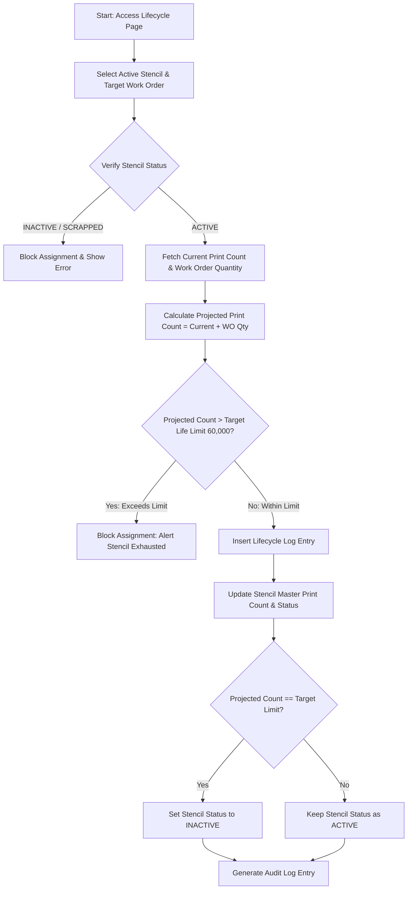

# SMT Manufacturing Execution System (MES)
## VERSION 2.0: STENCIL LIFE CYCLE MANAGEMENT

### 1. DOCUMENT CONTROL & VERSION INFORMATION
| Metadata Field | Value |
| :--- | :--- |
| **Module Name** | Stencil Management - Life Cycle |
| **Module Version** | 2.0 |
| **Document Version** | 2.0.0 |
| **Last Updated Date** | 2026-06-27 |
| **Author** | SMT Quality and Software Engineering Group |

#### Revision History
| Version | Date | Author | Description of Change |
| :--- | :--- | :--- | :--- |
| 2.0.0 | 2026-06-27 | SMT Quality & SE Group | Initial release detailing life cycle thresholds, cumulative printing counts, and override rules. |

---

### 2. MODULE OVERVIEW
The **Stencil Life Cycle Management** module tracks the physical wear, usage, and consumption of registered SMT stencil foils. Every time a stencil is mounted on a printer to process a Work Order, its aperture integrity degrades slightly. The system monitors cumulative PCB printing cycles against manufacturer wear tolerances to enforce timely retirement and maintain printing quality.

---

### 3. PURPOSE
Printing stencils have a finite service life (typically 60,000 prints). Exceeding this limit causes aperture wear, foil deformation, and tension loss, resulting in paste bleeding, bridging, or insufficient paste transfer. This module:
*   Enforces a strict upper ceiling on print cycles (60,000 default target).
*   Prevents scheduling production runs that would exceed the stencil's safe usage limit.
*   Automates the transition of stencil records from `ACTIVE` to `INACTIVE` when limits are reached.
*   Enforces a double-check system where only Super Admins can delete lifecycle logs or reverse print count increments.

---

### 4. NAVIGATION
Users can access this page by:
1. Logging into the SMT Portal.
2. Expanding the sidebar and selecting **SMT -> Stencil Management -> Stencil Lifecycle**.
3. Direct URL access route: `/smt/stencil-management/lifecycle`.

---

### 5. PAGE OVERVIEW & LAYOUT
The page interface provides a live view of lifecycle parameters:
1.  **Work Order Assignment Panel**: Centralized inputs to bind a stencil to an active Work Order.
2.  **Aperture Consumption Display**: Circular progress rings or indicators displaying the selected stencil's current life cycle status (e.g. `Used: 42,000 / 60,000`).
3.  **Active Assignment History Table**: Logs all current and past work order runs executed by each stencil plate.

---

### 6. PROCESS FLOW DIAGRAM
The following flow diagram illustrates the lifecycle allocation checks:

---

### 7. STEP-BY-STEP USER GUIDE
1.  Navigate to `/smt/stencil-management/lifecycle`.
2.  Select a stencil from the **Select Stencil** searchable dropdown. The system displays its current print metrics.
3.  Select the targeted Work Order from the **Select Work Order** dropdown.
4.  Review the auto-populated board side and quantity requirements.
5.  Enter any operational comments in the **Remarks** input.
6.  Click **Assign Work Order**. 
7.  Verify that the print count increments and the assignment is displayed in the history log.

---

### 8. FORM FIELDS
The allocation form links master inventory records to active manufacturing orders.

---

### 9. FIELD DESCRIPTION TABLE
| Field Name | Purpose | Data Type | Mandatory | Example Value | Validation Rules |
| :--- | :--- | :--- | :--- | :--- | :--- |
| **Select Stencil** | Links the stencil plate to be tracked. | Searchable Dropdown | Yes | `STM-000004` | Stencil must be registered and `ACTIVE`. |
| **Select Work Order** | Identifies the production run. | Searchable Dropdown | Yes | `WO202606200001` | Work order must contain a valid quantity. |
| **Remarks** | Details on printer setup or tension check. | Text | No | `Mounting on Printer 2` | Optional text input. |

---

### 10. VALIDATION RULES
*   **Active Gate**: The system rejects assigning stencils marked as `INACTIVE` or `SCRAPPED`.
*   **Duplicate Prevention**: A single Work Order cannot be assigned to the same stencil more than once.
*   **Capacity Limit Gate**: If the projected total prints (existing print count + work order print quantity) exceeds the stencil's target limit (e.g. 60,000), the assignment is blocked.

---

### 11. BUSINESS RULES
*   **Why is the 60,000 limit strictly enforced?** Repeated scraping by squeegees causes stencil friction wear, scratching the metal and stretching the apertures. Beyond 60,000 cycles, printing accuracy degrades, causing defects.
*   **Why does the system block duplicate work order assignments?** A work order represents a fixed quantity of board prints. Assigning it twice would double-count the prints in the system, rendering lifecycle metrics inaccurate.
*   **Why is lifecycle deletion restricted to Super Admins?** Deleting a lifecycle entry subtracts prints from a stencil's lifetime log. Operators must not have access to this action, as it could be used to bypass print limits and run worn stencils.

---

### 12. WORKFLOW LOGIC & PROGRESSION
*   **Status: Available** $\rightarrow$ Stencil print count is `0`.
*   **Status: Running** $\rightarrow$ Stencil has print counts greater than 0 but below the 60,000 limit.
*   **Status: Completed** $\rightarrow$ Print count reaches the target limit. The stencil is automatically marked `INACTIVE`.

---

### 13. USER ROLES & PERMISSIONS
*   **Operators / Supervisors**: Can view lifecycle stats, search records, and assign work orders to stencils.
*   **QA Inspectors**: Can review usage logs and audit printing history.
*   **Super Admins**: Authorized to execute soft-deletions on lifecycle logs, which automatically subtracts the prints and restores the stencil's status to `ACTIVE` if print count falls below the target.

---

### 14. GRID & TABLE COLUMN DESCRIPTIONS
#### Lifecycle Assignment History Grid
*   **Stencil Name / ID**: Plate identifiers.
*   **Work Order ID**: Assigned production job.
*   **Product Name**: PCB assembly code.
*   **Quantity Run**: Print strokes added by this work order.
*   **Remaining Life**: Balance of prints left before stencil retirement.
*   **Assignment Date**: Timestamp when the run was logged.
*   **Status**: Execution status of the run (`Running`, `Completed`).

---

### 15. USER ACTIONS
*   **Assign Work Order**: Validates parameters and locks prints.
*   **Deduct / Undo Assignment**: Super Admin action to delete a log entry and decrement the stencil's print count.

---

### 16. APPROVAL PROCESS
*   **Over-Limit Overrides**: If a critical run must proceed with a stencil near its wear limit, a quality supervisor must approve the exception and record formal authorization remarks.
*   **Reactivation Approval**: Reactivating an `INACTIVE` stencil requires visual inspection of the aperture tension and approval from the manufacturing manager.

---

### 17. AUDIT & TRACEABILITY
*   All additions or deletions of lifecycle records are logged in the `audit_log` table.
*   Deletions track the name of the Super Admin executing the correction and the exact quantity of prints deducted from the stencil master.

---

### 18. ERROR MESSAGES
*   *Error*: `"Cannot assign this Work Order. The selected stencil has reached its maximum life cycle."*
    *   **Reason**: Stencil has run out of print capacity.
*   *Error*: `"This Work Order has already been assigned to this stencil."*
    *   **Reason**: Duplicate assignment attempt.

---

### 19. TROUBLESHOOTING
*   **Issue**: Dropdown search is not showing my stencil.
    *   **Solution**: Ensure the stencil is active and has not been retired or scrapped in the Stencil Master page.
*   **Issue**: Print count does not match physical board count.
    *   **Solution**: Verify if any panels were discarded before printing. Super Admins can adjust the records to resolve count discrepancies.

---

### 20. FREQUENTLY ASKED QUESTIONS (FAQ)
*   **What happens if a stencil is damaged at 30,000 prints?**
    *   The quality supervisor must change the stencil's status to `SCRAPPED` in the Stencil Master page. This immediately removes it from active selection in the lifecycle module.
*   **Can a stencil be assigned to multiple work orders simultaneously?**
    *   No. A stencil can only be mounted on one printing machine at a time. The system enforces sequential scheduling.

---

### 21. SUMMARY & BEST PRACTICES
*   Always confirm that the stencil aperture side (TOP/BOTTOM) matches the PCB side specified in the Work Order before mounting.
*   Perform tension tests every 10,000 prints to ensure alignment accuracy.
