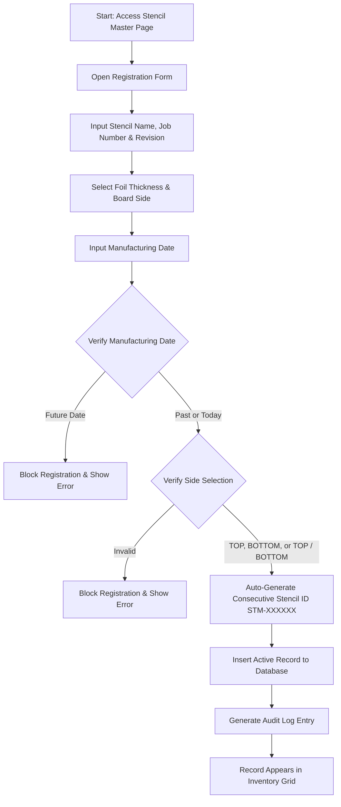

# SMT Manufacturing Execution System (MES)
## VERSION 2.0: STENCIL MASTER RECORD

### 1. DOCUMENT CONTROL & VERSION INFORMATION
| Metadata Field | Value |
| :--- | :--- |
| **Module Name** | Stencil Management - Master Record |
| **Module Version** | 2.0 |
| **Document Version** | 2.0.0 |
| **Last Updated Date** | 2026-06-27 |
| **Author** | SMT Quality and Software Engineering Group |

#### Revision History
| Version | Date | Author | Description of Change |
| :--- | :--- | :--- | :--- |
| 2.0.0 | 2026-06-27 | SMT Quality & SE Group | Initial release detailing the Stencil Master registration and authorization rules. |

---

### 2. MODULE OVERVIEW
The **Stencil Master Record** module acts as the central registry for all SMT printing stencil plates used on the assembly line. Stencils are precision-cut steel foils used to deposit solder paste onto circuit board pads. Each physical stencil must be logged and revision-controlled before it can be assigned to active production work orders.

---

### 3. PURPOSE
Stencils wear out, accumulate damages, or contain revisions that must match specific PCB layouts. The Stencil Master Record ensures that:
*   Only certified, damage-free stencils are registered.
*   Stencil properties (such as thickness and line side) are recorded to prevent printing defects.
*   A consecutive, standardized sequence identifier (`STM-XXXXXX`) is issued to each plate to establish traceability.
*   Editing and scraping permissions are restricted to supervisor and admin levels to enforce quality control.

---

### 4. NAVIGATION
Users can access this page by:
1. Logging into the SMT Portal.
2. Expanding the sidebar and selecting **SMT -> Stencil Management -> Stencil Master**.
3. Direct URL access route: `/smt/stencil-management/master`.

---

### 5. PAGE OVERVIEW & LAYOUT
The page layout provides clear segmentation of operations:
1.  **Stencil Registration Form**: Side panel or header form to log new stencil physical parameters.
2.  **Search & Filter Controls**: Text filters to search by Stencil Name, Job Number, or Revision.
3.  **Stencil Inventory Grid**: A paginated list of all active stencil records, displaying current status (`ACTIVE`, `INACTIVE`, `SCRAPPED`), print counts, and creation metadata.
4.  **Export & Control Buttons**: Actions to download Excel inventory sheets or trigger editing modals.

---

### 6. PROCESS FLOW DIAGRAM
The following flow diagram illustrates the stencil registration and validation process:

---

### 7. STEP-BY-STEP USER GUIDE
1.  Navigate to `/smt/stencil-management/master`.
2.  Fill in the **Stencil/Model Name** (corresponds to the assembly product code).
3.  Enter the engineering **Job Number** and **Revision** code.
4.  Specify the **Thickness** (in mils) and select the board **Side** (TOP, BOTTOM, or TOP / BOTTOM).
5.  Input the **Manufacturing Date** using the calendar date picker.
6.  Input the physical **Storage Location** rack/bin code.
7.  Click **Submit** to register the stencil. The system will auto-generate the sequential ID (e.g. `STM-000012`).

---

### 8. FORM FIELDS
The registration form contains fields to define the physical stencil foil specifications and storage tracking.

---

### 9. FIELD DESCRIPTION TABLE
| Field Name | Purpose | Data Type | Mandatory | Example Value | Validation Rules |
| :--- | :--- | :--- | :--- | :--- | :--- |
| **Stencil ID** | System-issued serial code. | Text | No (Auto) | `STM-000004` | Generated consecutively by the system. |
| **Stencil Name** | Model name or assembly code. | Text | Yes | `A82-Mainboard` | Must be a unique identifier. |
| **Job Number** | Gerber file tool job number. | Text | Yes | `JOB-84092` | Cannot be empty. |
| **Revision** | Gerber revision stamp. | Text | Yes | `Rev A.2` | Cannot be empty. |
| **Thickness (mils)** | Foil sheet thickness. | Number/Text | Yes | `5.0` | Must be a positive value. |
| **Side** | Targeted PCB side for paste deposition. | Dropdown Selection | Yes | `TOP` | Must be: `TOP`, `BOTTOM`, or `TOP / BOTTOM`. |
| **Storage Location** | Physical rack or shelf coordinate. | Text | No | `Rack-C2-Bin4` | Text character length maximum of 100. |
| **Remarks** | Special notes or damage reports. | Text | No | `Inspected under microscope` | Optional text field. |

---

### 10. VALIDATION RULES
*   **Date Gate**: The Manufacturing Date must be less than or equal to the current system date. Future dates are blocked.
*   **Foil Side Gate**: The side field is strict. The system only accepts `'TOP'`, `'BOTTOM'`, or `'TOP / BOTTOM'`.
*   **Uniqueness**: The generated `Stencil ID` must be checked against the database to guarantee sequential uniqueness.

---

### 11. BUSINESS RULES
*   **Why is the manufacturing date restricted from the future?** A stencil cannot exist on a shop floor before it is physically manufactured. Blocking future dates prevents errors during record setup.
*   **Why are editing and scraping restricted by role?** Standard operators must not be able to alter stencil revision numbers or mark a stencil as scrapped. Only quality supervisors and managers can authorize these actions.
*   **Why is the sequential STM prefix enforced?** Uniform serial numbering ensures that stencils can be integrated with automated scanning guns on screen printers.

---

### 12. WORKFLOW LOGIC & PROGRESSION
1.  **Creation**: Inserts record into `stencil_master` with status set to `ACTIVE` and `print_count` set to 0.
2.  **Usage (Downstream)**: The stencil becomes eligible for lifecycle allocation under Stage 2 (Lifecycle Management).
3.  **Retirement**: When print counts reach target limits or damage occurs, authorized roles update the status to `INACTIVE` or `SCRAPPED`.

---

### 13. USER ROLES & PERMISSIONS
*   **Operators**: Allowed to view stencil records, search inventory, and execute Excel exports.
*   **Managers / Supervisors**: Allowed to create and update records (modify storage location, status, revision).
*   **Super Admins / Admins**: Allowed to delete (soft delete) records.

---

### 14. GRID & TABLE COLUMN DESCRIPTIONS
#### Stencil Master Inventory Grid
*   **Stencil ID**: Auto-generated sequence barcode.
*   **Stencil/Model Name**: Assembly name.
*   **Job & Revision**: Engineering tracking tags.
*   **Thickness & Side**: Physical dimensions.
*   **Storage Location**: Physical warehouse shelf.
*   **Print Count**: Cumulative lifetime print strokes logged.
*   **Status**: `ACTIVE`, `INACTIVE`, or `SCRAPPED`.

---

### 15. USER ACTIONS
*   **Register Stencil**: Creates the master plate row.
*   **Edit Stencil**: Modifies parameters (Admin/Manager only).
*   **Soft Delete**: Removes record from grids (Admin only).
*   **Export Excel**: Generates a formatted spreadsheet of the current stencil inventory.

---

### 16. APPROVAL PROCESS
*   **Scrapping Approval**: Transitioning a stencil to `SCRAPPED` status requires a manager's verification and remarks explaining the reason (e.g. foil deformation).
*   **Creation Verification**: The system validates inputs automatically before allowing database insert.

---

### 17. AUDIT & TRACEABILITY
*   Every insert, update, or soft delete generates a detailed row in the `audit_log` database table, capturing the actor's username, timestamp, and a JSON block of the old and new record values.

---

### 18. ERROR MESSAGES
*   *Error*: `"Access Denied: Only Admin or SMT Manager roles are authorized to edit."*
    *   **Reason**: Operator attempted to alter storage or revision fields.
*   *Error*: `"Manufacturing Date cannot be a future date."*
    *   **Reason**: Entering a date beyond today.

---

### 19. TROUBLESHOOTING
*   **Issue**: Cannot export Excel sheet.
    *   **Solution**: Verify your network connection and ensure your browser is not blocking file downloads.
*   **Issue**: Stencil not appearing in active dropdowns in lifecycle page.
    *   **Solution**: Check if the stencil's status was accidentally marked as `INACTIVE` or `SCRAPPED`. Only `ACTIVE` stencils are visible in lifecycle dropdowns.

---

### 20. FREQUENTLY ASKED QUESTIONS (FAQ)
*   **What is the difference between INACTIVE and SCRAPPED?**
    *   `INACTIVE` stencils are temporarily suspended (e.g. pending cleaning or inspection). `SCRAPPED` stencils are permanently retired due to physical wear and cannot be reactivated.
*   **Can we change the Stencil ID once generated?**
    *   No. The `STM-XXXXXX` ID is a permanent primary key for physical traceability.

---

### 21. SUMMARY & BEST PRACTICES
*   Always input the exact rack bin code to prevent search delays on the shop floor.
*   Review print counts weekly to identify stencils nearing their wear limits.
