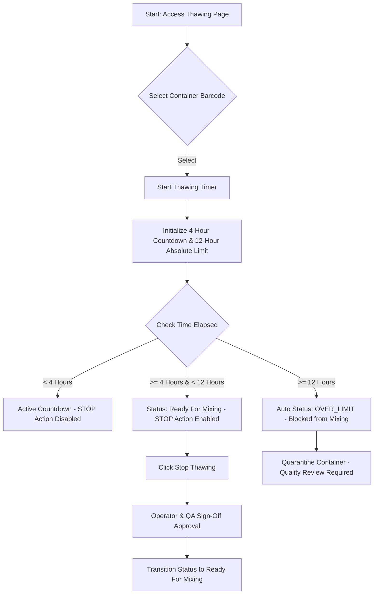

# SMT Manufacturing Execution System (MES)
## VERSION 2.0: SOLDER PASTE THAWING PROCESS CONTROL

### 1. DOCUMENT CONTROL & VERSION INFORMATION
| Metadata Field | Value |
| :--- | :--- |
| **Module Name** | Solder Paste Management - Stage 2 |
| **Module Version** | 2.0 |
| **Document Version** | 2.0.0 |
| **Last Updated Date** | 2026-06-27 |
| **Author** | SMT Quality and Software Engineering Group |

#### Revision History
| Version | Date | Author | Description of Change |
| :--- | :--- | :--- | :--- |
| 2.0.0 | 2026-06-27 | SMT Quality & SE Group | Initial release detailing the 4-hour thawing timer and 12-hour over-limit business logic. |

---

### 2. MODULE OVERVIEW
The **Thawing Process Control** page manages the secondary stage of solder paste conditioning: thermal equilibrium. Once a paste container is removed from cold storage, it must sit undisturbed at ambient shop-floor temperature (22°C $\pm$ 3°C) for a minimum of 4 hours to prevent moisture condensation and ensure proper flux solvent activation.

---

### 3. PURPOSE
Opening a cold solder paste jar immediately introduces atmospheric humidity that condenses on the cold metal particles. This moisture creates micro-voids and causes violent "outgassing" during reflow, which results in scattered solder balls and bridging. The thawing module enforces a rigid time-based checkpoint that blocks downline mixing until the paste is physically ready.

---

### 4. NAVIGATION
Users can access this page by:
1. Navigating to the main **Solder Paste Management** dashboard.
2. Clicking on the **Stage 2: Thawing Timer** tab, OR navigating directly to the URL route: `/smt/solder-paste/thawing`.

---

### 5. PAGE OVERVIEW & LAYOUT
The Thawing page features a structured layout designed for real-time monitoring:
1.  **Thawing Initiation Panel**: Operator selects a jar registered from Stage 1 (Removal) to start its thawing timer.
2.  **Active Thawing Grid**: Displays containers currently undergoing thawing with a live counting clock.
3.  **Completed Thawing Grid**: Lists containers that have finished the 4-hour warming window.
4.  **Over-Limit Quarantine Grid**: Highlights jars that have been left at room temperature for more than 12 hours.

---

### 6. PROCESS FLOW DIAGRAM
The following diagram represents the thawing state progression and limit checks:

---

### 7. STEP-BY-STEP USER GUIDE
1.  Navigate to `/smt/solder-paste/thawing`.
2.  In the initiation panel, select the target **Container Barcode / Work Order ID** from the list of jars that have completed Stage 1.
3.  Enter the **Operator ID** and click **Start Thawing**. A live timer will display on the screen.
4.  Monitor the countdown timer. The "Stop" option is disabled until the timer reaches `00:00:00` (representing 4 hours).
5.  Once the countdown completes, click **Stop Thawing**.
6.  An approval modal will appear. Input the **Operator ID** and **QA Inspector ID**.
7.  Click **Confirm**. The jar is now released for Stage 3 (Mixing).

---

### 8. FORM FIELDS
The thawing form links removal data to active timers and logs authorizations.

---

### 9. FIELD DESCRIPTION TABLE
| Field Name | Purpose | Data Type | Mandatory | Example Value | Validation Rules |
| :--- | :--- | :--- | :--- | :--- | :--- |
| **Solder Paste Barcode** | Selects the jar ready to thaw. | Dropdown Selection | Yes | `SP-B40291` | Must have completed Stage 1. |
| **Operator Name/Code** | Identifies who started the thawing run. | Text | Yes | `OP-1002` | Must match a registered operator account. |
| **Thawing Start Time** | Records when warming began. | DateTime | Yes | `2026-06-27 08:00:00` | Set automatically by the system clock. |
| **Thawing Duration Clock** | Tracks the active warming duration. | Countdown Clock | Yes | `02:45:10` | Updates dynamically in HH:MM:SS format. |
| **QA Approver ID** | Credentials of the inspector certifying completion. | Text | Yes | `QA-9883` | Must be an authorized QA code. |

---

### 10. VALIDATION RULES
*   **Minimum Thawing Duration**: The system blocks any attempt to stop the thawing timer before 4 hours (14,400 seconds) have elapsed. *(Note: For testing and validation purposes, the minimum limit is temporarily set to 1 minute in the sandbox environment).*
*   **Absolute 12-Hour Ceiling**: If a jar is left at room temperature for more than 12 hours (43,200 seconds) without being mixed, the system flags it as `OVER_LIMIT` and locks the record.
*   **Sequential Enforce**: The system blocks starting a thawing process for any jar that has not completed Stage 1 (Removal).

---

### 11. BUSINESS RULES
*   **Why must thawing be at least 4 hours?** Jars contain dense metallic mass. Warmed too quickly or used cold, temperature variances cause internal condensation and alter viscosity, resulting in printing defects.
*   **Why is there a 12-hour maximum limit?** Ambient room temperature starts the chemical reaction of the flux. If left unmixed and unused for over 12 hours, the solvents evaporate, leading to dry paste that clogs the printing stencil.
*   **Why do we require QA Sign-off to stop thawing?** The QA inspector must check that the container did not experience any thermal fluctuations during warming and is clean of external moisture before it goes to the mixer.

---

### 12. WORKFLOW LOGIC & PROGRESSION
#### Practical Timeline Examples
*   **Scenario A: Normal Execution (Success)**
    *   **08:00 AM**: Operator registers a jar removal and clicks "Start Thawing". The system records the start time as `08:00:00`.
    *   **08:00 AM – 12:00 PM**: The countdown clock ticks down. The "Stop" action is locked.
    *   **12:00 PM**: The timer reaches `00:00:00`. The status changes to **Ready for Mixing**.
    *   **12:15 PM**: The operator clicks "Stop", inputs their ID and the QA inspector's ID. The jar status updates to **Completed Thawing**.
*   **Scenario B: Over-Limit Expiration (Failure)**
    *   **08:00 AM**: Operator starts thawing.
    *   **12:00 PM**: Warming is complete. The jar is left on the bench.
    *   **08:00 PM**: 12 hours have elapsed since `08:00:00`. The system automatically updates the status to **OVER_LIMIT** and locks the container from downline mixing.

---

### 13. USER ROLES & PERMISSIONS
*   **SMT Operators**: Allowed to select containers, start thawing timers, and view countdowns.
*   **QA Inspectors / Supervisors**: Required to sign off on the Stop Thawing approval modal.
*   **Super Admin**: Can override and reset a locked `OVER_LIMIT` container in extreme cases if physical quality tests pass (subject to strict logging).

---

### 14. GRID & TABLE COLUMN DESCRIPTIONS
#### Active Thawing Grid
*   **Barcode / WO ID**: Unique container identifiers.
*   **Start Date & Time**: Timestamp when the timer was initiated.
*   **Elapsed Time**: Real-time duration since warming started.
*   **Remaining Time**: Time left until the 4-hour threshold is met.
*   **Status**: Displays `In Progress` or `Ready for Mixing`.

---

### 15. USER ACTIONS
*   **Start Thawing**: Captures system time and starts the countdown.
*   **Stop Thawing**: Triggers approval modal to complete the stage.

---

### 16. APPROVAL PROCESS
Upon clicking **Stop Thawing**:
1.  Verify the countdown shows `00:00:00`.
2.  The QA inspector must physically verify that the container is at room temperature.
3.  The inspector inputs their employee ID into the approval dialog.

---

### 17. AUDIT & TRACEABILITY
*   The start and end times, operator ID, and QA verifier ID are written to the `smt_inspections` database.
*   If a jar transitions to `OVER_LIMIT`, a system-generated audit log entry is recorded automatically.

---

### 18. ERROR MESSAGES
*   *Error*: `"Cannot stop thawing: Minimum duration of 4 hours has not been met."*
    *   **Reason**: Attempting to bypass the warming gate.
*   *Error*: `"This container is OVER LIMIT and cannot be processed."*
    *   **Reason**: Jar exceeded 12 hours at room temperature.

---

### 19. TROUBLESHOOTING
*   **Issue**: Timer shows negative time.
    *   **Solution**: Check the client PC system clock. If the client clock drifts from the server clock, adjust it to match.
*   **Issue**: The container barcode is missing from the list.
    *   **Solution**: Verify the container was registered on the Removal page (Stage 1) first.

---

### 20. FREQUENTLY ASKED QUESTIONS (FAQ)
*   **What should we do if a power outage stops the screen timer?**
    *   The system calculates duration using database timestamps (`Thawing Start Time` vs. `Current Time`), so the timer will resume correctly when power is restored.
*   **Can we speed up thawing using warm water or an oven?**
    *   Absolutely not. Forced heating ruins the flux consistency and voids the material warranty.

---

### 21. SUMMARY & BEST PRACTICES
*   Always start the thawing timer immediately upon placing the jar on the warming bench.
*   Monitor the dashboard to ensure containers are mixed before reaching the 12-hour limit.
